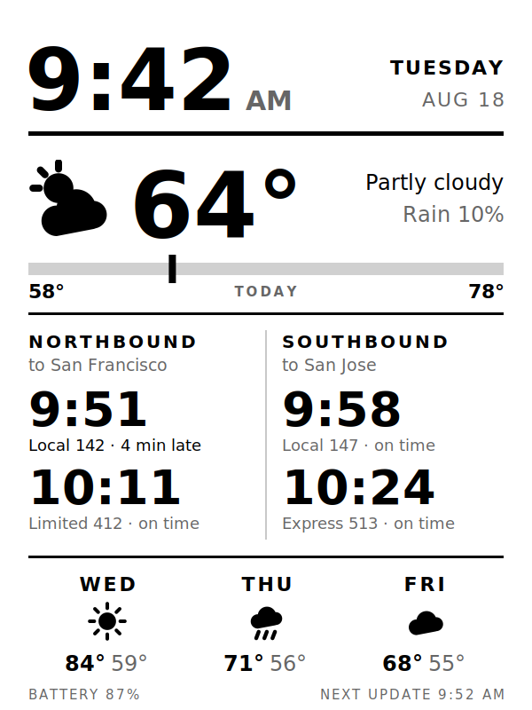

# kindle-dashboard

I had an old Kindle sitting in a drawer, so I turned it into a little e-ink
display for my desk. It shows the time, the weather, and the next two Caltrain
departures each way from Menlo Park. Everything runs on the Kindle itself, so
there's no server to keep running and nothing to pay for. It wakes up, grabs
fresh data, redraws the screen, and goes back to sleep. On battery it lasts a
good while between charges.



I built it on a Kindle Basic (8th/10th gen, 600×800 screen) running firmware
5.14.3. Other models should work, but you'd have to resize the layout in
`svg/template.svg` to fit your screen.

The trains are there because that's what I check every morning. You probably
don't take Caltrain, and that's fine. The point of this repo is the plumbing:
getting a Kindle to wake up, fetch whatever you want, draw it, and sleep. Swap
the train panel for whatever's useful to you. There's a section on
[making it your own](#making-it-your-own) with ideas and how to do it.

This guide goes from a stock Kindle to a working dashboard. Plan on an hour or
two the first time, mostly downloading things and waiting on reboots.

---

## Before you start

You'll need:

- A Kindle you're fine never reading on again (you can switch back, but
  you won't want to keep flipping between the two)
- A computer and a USB cable
- Your Wi-Fi password and access to your router's settings
- A free account on [MobileRead](https://www.mobileread.com/forums/) for some of
  the downloads

**Check your firmware first.** On the Kindle, go to Settings → Device Options →
Device Info and write down the version number. Whether you can jailbreak at all
depends on it, and if the Kindle updates itself before you're done, you may lose
your chance. So once you've got the number, turn on Airplane Mode and leave it
on until step 2 tells you otherwise.

---

## Step 1: Jailbreak the Kindle

I'm not going to rewrite the jailbreak guide here, because the KindleModding
folks keep theirs up to date and it changes as Amazon patches things.

1. Put your firmware version into the
   [KindleModding jailbreak finder](https://kindlemodding.org/jailbreak-wizard.html).
   It tells you which method works for your Kindle.
2. Follow that method's guide all the way through. For most older Kindles it's
   [WinterBreak](https://kindlemodding.org/jailbreaking/WinterBreak/), which is
   what I used.
3. When it works you'll see a "Jailbroken" book in your library.

If you used WinterBreak, the hotfix (which keeps the jailbreak after a reboot)
is already installed. The KindleModding guides mention a separate hotfix step
for some methods; skip it if your method says it's included. You'll know
something's wrong if the "Update Your Kindle" button stays grayed out when a
guide asks you to press it, and that's the usual reason.

## Step 2: Stop it from updating

A Kindle update can undo the jailbreak, so block updates before you go any
further. Do at least one of these:

- **Block it at your router.** Find the Kindle in your router's device list and
  block its internet access. The dashboard needs the internet later, so either
  allow just `api.open-meteo.com` and `api.511.org` (if your router can do
  per-site rules) or unblock it again at the end and accept a small risk.
- **Fill up its storage.** Updates need several hundred MB of free space to
  download. If you do this, leave about 150 MB free, not zero. The dashboard
  needs a little room for its log and images, and if you fill it all the way it
  crashes with "no space left on device." (Ask me how I know.) There's a
  script for this in [Troubleshooting](#troubleshooting).

## Step 3: Install KUAL, MRPI and Python

KUAL is a launcher for homebrew apps, and MRPI installs packages. Follow
KindleModding's
[KUAL and MRPI guide](https://kindlemodding.org/jailbreaking/Legacy/post-jailbreak/installing-kual-mrpi/).
When you're done you'll have a KUAL book in your library.

Then install Python. From
[NiLuJe's snapshots thread](https://www.mobileread.com/forums/showthread.php?t=320564),
download the Python package and grab the file named
`Update_python3_*_install_pw2_and_up.bin`. Not the one without the 3 (that's
Python 2), and not `touch_pw` (that's for much older Kindles).

While you're there, it's worth grabbing USBNetwork too
(`Update_usbnet_*_install_pw2_and_up.bin`). It lets you SSH into the Kindle,
which helps a lot if something goes wrong.

Copy the `.bin` files into the `mrpackages` folder on the Kindle, eject it,
unplug it, and type `;log mrpi` into the Kindle's search bar. The screen might
go blank for a bit and you might get an "Application Error" popup. Both are
normal.

You don't need to install FBInk separately. It comes with the Python package.

## Step 4: Get the extra files

A few things aren't in this repo because they're other people's binaries or
change over time. Download this repo first (green Code button → Download ZIP,
then unzip it), then:

| What | Put it in | Where to get it |
|---|---|---|
| `rsvg-convert` and the `rsvg-convert-lib` folder | `external/` | [4dcu-be/kual-dashboard](https://github.com/4dcu-be/kual-dashboard), in `dashboard/external/` |
| `cacert.pem` | `certs/` | [curl.se/ca/cacert.pem](https://curl.se/ca/cacert.pem) (right-click, Save As) |
| `DejaVuSans.ttf` and `DejaVuSans-Bold.ttf` | a `fonts` folder at the top level of the Kindle (not the one in this repo) | [dejavu-fonts.github.io](https://dejavu-fonts.github.io/) |

`rsvg-convert` turns the SVG layout into an image. The CA bundle is there
because the Kindle's own list of trusted certificates is years out of date, so
without it every HTTPS request fails.

## Step 5: Get a 511 API key

Skip this if you're not keeping the train panel. Without a key, that part of
the screen just says "add 511 key to api_key.txt" until you replace it with
something else.

The train times come from 511.org, the Bay Area's transit data service. Request
a free key on [511.org's open data page](https://511.org/open-data) (look for "Request a token"). It
shows up in your email within a few minutes.

Copy `api_key.example.txt` to `api_key.txt` and replace the text inside with
your key. `api_key.txt` is in `.gitignore`, so if you fork this, your key won't
get committed by accident.

## Step 6: Set your location

Open `bin/run.py`. The settings are at the top:

- `LAT` and `LON`: where to get the weather for
- `STOP_NB` and `STOP_SB`: your Caltrain station's stop codes, one for each
  direction. Menlo Park is 70161 (northbound) and 70162 (southbound). Every
  station follows the same pattern, ending in 1 for northbound and 2 for
  southbound. There's a full table in the
  [MMM-Caltrain README](https://github.com/zzhenney/MMM-Caltrain).
- `UNITS`: `fahrenheit` or `celsius`

If you're not on Pacific time, you also need to change the timezone in two
places, `TZ_API` and `TZ_LOCAL` in `run.py` and `TZ` in `bin/common.sh`. The
Kindle doesn't understand names like `America/New_York`, so `TZ_LOCAL` and
`common.sh` take a rule string instead. Eastern is
`EST5EDT,M3.2.0,M11.1.0`, Central is `CST6CDT,M3.2.0,M11.1.0`, Mountain is
`MST7MDT,M3.2.0,M11.1.0`.

## Step 7: Copy it to the Kindle

Plug in the Kindle and copy the whole folder into `extensions/`, renamed to
exactly `dashboard`. You should end up with `extensions/dashboard/config.xml`.
The name matters, because the KUAL menu points at that path.

Eject and unplug.

## Step 8: Test it

Open KUAL. You should see **Weather Dashboard**. Tap it, then
**Refresh once (test)**.

This draws one screen without shutting anything down, so if it fails you've
still got a working Kindle. The first time can take a couple of minutes while
it builds a font cache. After that it's 10 to 20 seconds.

If it doesn't draw, plug the Kindle in and open `extensions/dashboard/dashboard.log`.
Wait until it's had time to finish first, because plugging in USB kills
anything that's still running.

## Step 9: Start it for real

Once the test works, turn Airplane Mode off (so it can reach the internet), then
go to KUAL → Weather Dashboard → **Start**.

The screen goes white for a minute or so while the normal Kindle software shuts
down, and then the dashboard shows up. After that it sleeps between updates,
so it'll look frozen. That's on purpose; it's what makes the battery last.
The bottom-right corner shows when the next update is.

To get your normal Kindle back, hold the power button until it reboots (it can
take up to a minute). The dashboard never starts on its own after a reboot.

---

## How often it updates

On weekday mornings and evenings (6–10am, 4–8pm) it updates every 10 minutes.
The rest of the day it's every 20. Between 1:30 and 4:45am, when no trains run,
it doesn't wake up at all. It also always wakes up right after the first train
on screen leaves, so it's never showing you a train that's already gone.

You can change all of this at the top of `bin/run.py`. For testing, set
`REFRESH_SECONDS` in `bin/start.sh` to a fixed number of seconds. Don't go
below 180: each update uses two 511 requests, and they only allow 60 an hour.

## Changing the layout

The layout is `svg/template.svg`. It's a normal SVG with placeholders like
`{{TEMP}}` that the script fills in. You can open it in a browser to see your
changes before copying it over. Everything's positioned by hand on a 600×800
grid, so if you move something, check that nothing overlaps.

## Making it your own

The screen is split into panels: the clock, current weather, trains, and the
forecast. Each panel is some placeholders in `svg/template.svg` plus the code
in `bin/run.py` that fills them in. To swap one out:

1. Write a function in `run.py` that fetches your data and returns it. Look at
   `fetch_weather()` for a simple example. It's one HTTPS request and some JSON.
2. In `build_fields()`, turn that data into strings and put them in `fields`,
   like `fields["STEPS"] = "8,214"`.
3. In `template.svg`, put `{{STEPS}}` wherever you want it to show up.
4. Delete the old panel's code and placeholders, and the `fill_trains()` calls
   if it's the trains you're replacing.

A few things to keep in mind on a Kindle:

- Keep requests few and fast. Every second it's awake with Wi-Fi on costs
  battery, and each HTTPS request takes a few seconds on this CPU.
- The screen only changes when it wakes up. Show things as times ("leaves at
  8:14") rather than countdowns ("in 4 min"), since a countdown is wrong the
  moment it's drawn.
- It's grayscale and the pixels are big. Bold, large text and solid shapes
  look good. Thin lines and light grays mostly disappear.
- Stick to APIs that take a simple key or token, or none at all. Anything
  that makes you sign in through a browser (OAuth) is a pain on a Kindle.

### Ideas

**If you're in the Bay Area but don't ride Caltrain.** 511 covers almost every
agency. Change `agency=CT` in `fetch_departures()` to `BA` for BART, `SF` for
Muni, `AC` for AC Transit, or `SM` for SamTrans, and change the stop codes. The
same key works.

**Other transit.** Lots of cities publish real-time arrivals. In NYC there's
the MTA's feeds, in Chicago the CTA Train Tracker API, and many US agencies
are on [Transit.land](https://www.transit.land/). Anywhere with a GTFS-realtime
feed will work, though parsing those is more involved than JSON.

**Calendar.** Google Calendar and iCloud both give you a private `.ics` link
for each calendar. Fetch it, pull out today's events, and show the next two or
three. No login needed.

**More weather.** [Open-Meteo](https://open-meteo.com/en/docs) is already
wired up and can also give you sunrise and sunset, UV index, wind, or an hourly
temperature graph. It has a separate
[air quality API](https://open-meteo.com/en/docs/air-quality-api) too, handy
during fire season.

**Home Assistant.** If you run it, its REST API can give you any sensor in your
house: indoor temperature, whether the garage is open, the power your solar
panels are making. [4dcu-be/kual-dashboard-ha](https://github.com/4dcu-be/kual-dashboard-ha)
does exactly this and is a good reference.

**A to-do list.** Point it at a Todoist or Notion API, or just a text file you
keep in a GitHub gist and edit from your phone.

**Stuff that changes slowly.** Stock or crypto prices, your GitHub
contributions for the week, a word of the day, a random quote, the next
holiday or a countdown to something. These suit an e-ink screen well because
nobody needs them to the minute.

**Rotate between screens.** Draw a different layout depending on the time of
day, like trains and weather in the morning and your calendar in the
afternoon. It's just an `if` on the hour and a second template file.

If you build something cool with this, I'd like to see it. Open an issue with
a photo.

---

## Troubleshooting

Everything gets written to `dashboard.log` in the extension folder, including
how long each step took and how much free space is left. That's the first place
to look.

**KUAL doesn't show Weather Dashboard.** KUAL looks for `config.xml`, and it
has to be directly inside `extensions/dashboard/`. Unzipping sometimes adds an
extra folder layer, like `extensions/dashboard/kindle-dashboard/config.xml`.

**`CERTIFICATE_VERIFY_FAILED` in the log.** `certs/cacert.pem` is missing.

**`Temporary failure in name resolution`.** The Kindle can't reach the internet.
Check Airplane Mode and your router block.

**"add 511 key to api_key.txt" on screen.** The key file is missing, or still
has the placeholder text in it.

**Letters show up as boxes.** The DejaVu fonts aren't in the `fonts` folder at
the top level of the Kindle.

**Times are hours off.** The timezone is wrong. See step 6.

**"No space left on device".** Your storage is full, almost always from the
filler you made in step 2. Delete it and make a new one that leaves 150 MB
free. On a Mac, with the Kindle plugged in and your filler files in a folder
called `fill_disk`:

```sh
cd /Volumes/Kindle/fill_disk
rm -f *
avail=$(df -m . | awk 'NR==2 {print $4}')
fill=$((avail - 150))
i=1
while [ $fill -gt 0 ]; do
  chunk=$(( fill > 3000 ? 3000 : fill ))
  dd if=/dev/zero of=filler$i.dat bs=1m count=$chunk
  fill=$((fill - chunk)); i=$((i+1))
done
df -h .
```

It writes in 3 GB pieces because the Kindle can't store a single file bigger
than 4 GB. The files end in `.dat` on purpose: the Kindle treats any `.bin`
file at the top level as an update.

**It draws once and never updates.** The wake timer is probably on a different
path on your model. SSH in, run `ls /sys/class/rtc/`, and if you only see
`rtc0`, change `rtc1` to `rtc0` on the `RTC=` line in `bin/start.sh`.

**Start just gives a white screen forever.** Give it two minutes first. If it's
still white, reboot and check the log for what happened after
`waiting for framework teardown`.

---

## Thanks

This leans on a lot of other people's work:

- [NiLuJe](https://github.com/NiLuJe) for FBInk, the Python package, and
  basically every Kindle tool that matters
- [KindleModding](https://kindlemodding.org) for WinterBreak and the guides
- [4dcu-be/kual-dashboard](https://github.com/4dcu-be/kual-dashboard) and
  [x-magic/kindle-weather-stand-alone](https://github.com/x-magic/kindle-weather-stand-alone),
  where I got the idea of rendering SVGs on the Kindle and the `rsvg-convert`
  build
- [Open-Meteo](https://open-meteo.com) for free weather data with no API key
- [511.org](https://511.org/open-data) for the train data

## License

MIT. See [LICENSE](LICENSE). The files you download in step 4 have their own
licenses.
